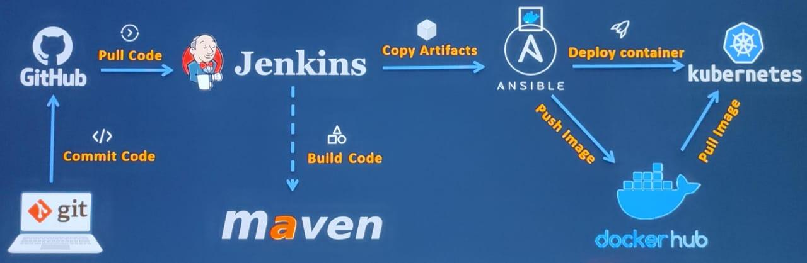
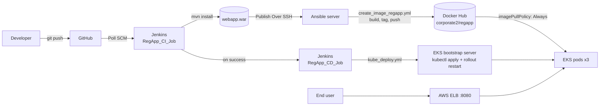
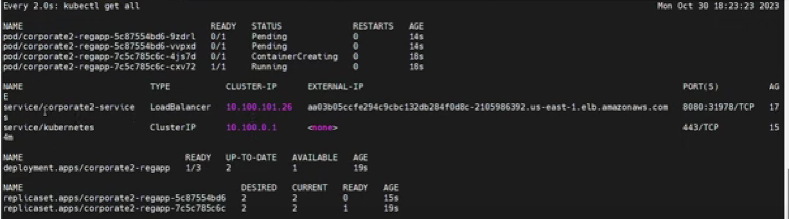
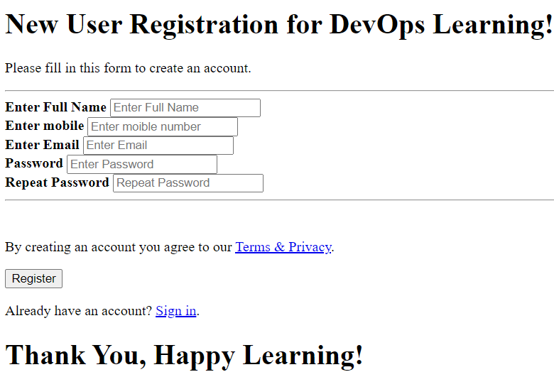
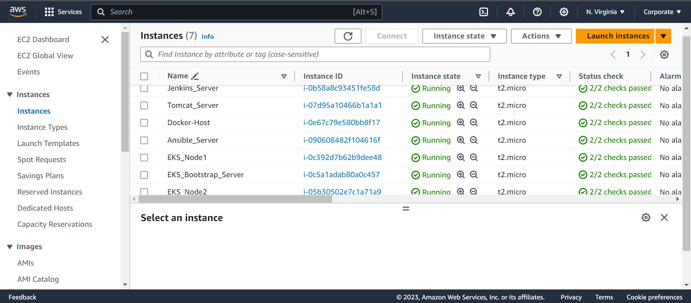

# AWS DevOps CI/CD Pipeline: Git → Jenkins → Maven → Ansible → Docker → Kubernetes (EKS)

[](https://github.com/aniketnandi/AWS-Personal-Projects/actions/workflows/devops-pipeline.yml)

A complete CI/CD pipeline on AWS. A commit to GitHub builds a Java web app, packages it into a Docker image, publishes it to Docker Hub, and rolls it out to an **Amazon EKS** cluster behind an Elastic Load Balancer with no manual steps.

I built it in four stages. Each stage adds one tool to the pipeline and replaces a manual step with automation.



> **Reviewing this in 2 minutes?**
> 1. Watch the [demo video](https://drive.google.com/file/d/1XCPMsMGVa63H0cUDvO9HMZcQM9QgMOOj/view?usp=drive_link) of the pipeline running on AWS.
> 2. Read the [Ansible playbooks](ansible/) and [Kubernetes manifests](kubernetes/) that drove the deployment.
> 3. Open the latest [GitHub Actions run](https://github.com/aniketnandi/AWS-Personal-Projects/actions/workflows/devops-pipeline.yml). It rebuilds the app, the Docker image, and the Kubernetes deployment from this repo on every push.
> 4. Run it yourself with one Docker command ([below](#run-it-yourself)). No AWS account needed.

## Demo and documentation

| | |
|---|---|
| 🎥 **Demo video (full pipeline)** | [Watch on Google Drive](https://drive.google.com/file/d/1XCPMsMGVa63H0cUDvO9HMZcQM9QgMOOj/view?usp=drive_link) |
| 🎥 **Clip: Ansible playbook running Docker images through Jenkins** | [Ansible Playbook to run Docker Images through Jenkins.mp4](Ansible%20Playbook%20to%20run%20Docker%20Images%20through%20Jenkins.mp4) |
| 📄 **Step-by-step build guide with screenshots (14 pages)** | [AWS DevOps CI_CD Project Documentation.pdf](AWS%20DevOps%20CI_CD%20Project%20Documentation.pdf) |

## Tech stack

| Area | Tools |
|---|---|
| Source control | Git, GitHub |
| CI server | Jenkins (Freestyle and Maven jobs, Poll SCM, Publish Over SSH) |
| Build | Apache Maven (WAR packaging) |
| Configuration management | Ansible (inventory, playbooks, SSH key auth) |
| Containers | Docker, Docker Hub, Apache Tomcat base image |
| Orchestration | Kubernetes on Amazon EKS (`eksctl`, `kubectl`) |
| AWS | EC2 (Amazon Linux 2), EKS, Elastic Load Balancing, IAM, Elastic IP, Security Groups, CloudFormation (through eksctl) |

## How the final pipeline works



1. **Commit.** A developer pushes a change to the JSP web app on GitHub.
2. **CI.** `RegApp_CI_Job` polls SCM, builds the WAR with Maven, and copies it to the Ansible server over SSH.
3. **Image.** Ansible ([`create_image_regapp.yml`](ansible/create_image_regapp.yml)) builds a Tomcat-based Docker image containing the WAR, tags it, and pushes it to Docker Hub.
4. **CD.** If the build is stable, `RegApp_CD_Job` runs [`kube_deploy.yml`](ansible/kube_deploy.yml) against the EKS bootstrap server.
5. **Deploy.** The playbook applies the [Deployment](kubernetes/regapp-deployment.yml) (3 replicas, rolling update) and the [LoadBalancer Service](kubernetes/regapp-service.yml), then runs `kubectl rollout restart` so the pods pull the new image.
6. **Serve.** Traffic reaches the pods through the ELB that EKS provisions, at `http://<elb-dns>:8080/webapp`.

## Run it yourself

The original AWS environment (6 EC2 servers and an EKS cluster) has been deleted. Everything below runs on a laptop with Docker and builds the same application image.

**1. Build and run the container** (the Stage 2 and 3 result)

```bash
git clone https://github.com/aniketnandi/AWS-Personal-Projects.git
cd "AWS-Personal-Projects/AWS DevOps Project"

docker build -t regapp:local app
docker run --rm -p 8080:8080 regapp:local
# open http://localhost:8080/webapp
```

**2. Deploy to Kubernetes** (the Stage 4 result) with [kind](https://kind.sigs.k8s.io/) and `kubectl`

```bash
kind create cluster --name regapp
kind load docker-image regapp:local --name regapp

# The EKS manifests, with the image pointed at the local build
kubectl apply -k local-cluster
kubectl rollout status deployment/corporate2-regapp
kubectl get all

# EKS put an ELB in front of the LoadBalancer Service. Locally, port-forward instead:
kubectl port-forward service/corporate2-service 8080:8080
# open http://localhost:8080/webapp

# Same rolling update that kube_deploy.yml runs after each new image
kubectl rollout restart deployment/corporate2-regapp

kind delete cluster --name regapp   # clean up
```

**3. Watch it in CI.** [`.github/workflows/devops-pipeline.yml`](../.github/workflows/devops-pipeline.yml) runs the same flow on every push: Maven build → Ansible syntax check and Kubernetes schema validation → Docker build and smoke test → deploy to a kind cluster → service smoke test → rolling restart.

| On AWS (original) | Local / CI (this repo) |
|---|---|
| Jenkins `RegApp_CI_Job` polls GitHub | GitHub Actions on push |
| Maven on the Jenkins server | `mvn package` (in CI and in the Docker build stage) |
| Ansible builds the image and pushes it to Docker Hub | `docker build`, then `kind load` |
| Ansible runs `kubectl apply` on the EKS bootstrap server | `kubectl apply -k local-cluster` |
| EKS worker nodes + ELB | kind cluster + `port-forward` |

## Build stages

| Stage | Added | Result |
|---|---|---|
| **1. Git + Jenkins + Maven + Tomcat** | Jenkins on EC2 polls GitHub, builds with Maven, and deploys the WAR to a Tomcat EC2 server through the *Deploy to container* plugin | App served at `<tomcat-ip>:8080/webapp` |
| **2. Docker** | Jenkins copies the WAR to a Docker host, which rebuilds a Tomcat image and replaces the running container | App served from a container at `:8087` |
| **3. Ansible** | Image build, push, and container deployment move into Ansible playbooks. Passwordless SSH runs from the Ansible server (as `ansadmin`) to the Docker host | Repeatable deploys at `:8082` |
| **4. Kubernetes (EKS)** | `eksctl` creates the EKS cluster. Ansible applies the manifests, and separate CI and CD jobs are chained | Load-balanced, self-healing, 3-replica deployment behind an ELB |

## Repository contents

```
AWS DevOps Project/
├── ansible/
│   ├── hosts                       # inventory (kubernetes + ansible groups)
│   ├── create_image_regapp.yml     # build, tag, and push the Docker image
│   ├── docker_deployment.yml       # Stage 3: run the container on the Docker host
│   ├── kube_deploy.yml             # Stage 4: apply manifests and restart the rollout on EKS
│   └── kube_service.yml            # apply the Service only
├── app/
│   ├── Dockerfile                  # Maven build stage + Tomcat runtime serving /webapp
│   ├── pom.xml                     # parent POM
│   └── webapp/                     # WAR module (index.jsp registration page)
├── kubernetes/
│   ├── regapp-deployment.yml       # 3 replicas, RollingUpdate, imagePullPolicy: Always
│   ├── regapp-service.yml          # type: LoadBalancer on port 8080
│   └── kustomization.yaml
├── local-cluster/
│   └── kustomization.yaml          # same manifests, using the locally built image
├── jenkins/
│   └── README.md                   # CI/CD job configuration (SCM polling, SSH publishers, exec commands)
├── images/                         # screenshots used in this README
├── AWS DevOps CI_CD Project Documentation.pdf
└── Ansible Playbook to run Docker Images through Jenkins.mp4
```

The playbooks, manifests, and job settings are the configurations I used on the servers. I transcribed them from the screenshots in the project documentation.

The application under `app/` (a JSP registration page in a Maven WAR) and its multi-stage `Dockerfile` are rebuilt from the documentation so the pipeline can run from this repo. The original lived in a separate repository that Jenkins pulled from.

## Results

**EKS workloads (`kubectl get all`):** the Deployment, its ReplicaSets, and the LoadBalancer Service with its external ELB hostname.



**The deployed application, served through the ELB:**



**EC2 fleet** (Amazon Linux 2, `t2.micro`): Jenkins, Tomcat, Docker host, Ansible, EKS bootstrap server, and EKS worker nodes.



## What I learned

- **Separating CI from CD.** I split the pipeline into a build job and a deploy job and triggered the deploy job only on a stable build, so a broken build never reaches the cluster.
- **Replacing ad-hoc scripts with Ansible.** Moving shell commands out of Jenkins into idempotent, version-controlled playbooks made deployments repeatable and easier to troubleshoot.
- **Immutable images and rolling updates.** With `imagePullPolicy: Always` and `kubectl rollout restart`, each deploy replaces pods one at a time from a fresh image, and the app stays up during the rollout.
- **AWS infrastructure.** I configured security groups and ports for each tier, the IAM role for the EKS bootstrap server (EC2, CloudFormation, and IAM access), SSH key distribution between servers, and the ELB that EKS provisions.

> The AWS resources were deleted after the project to avoid ongoing costs, so the ELB address in the screenshots is no longer live. The demo video shows the pipeline running end to end.
