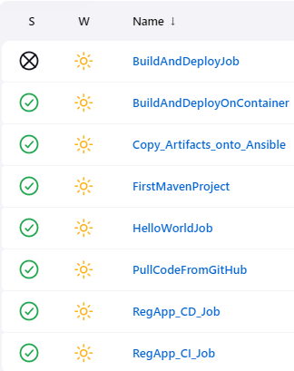

# Jenkins Job Configuration

The pipeline was built with Jenkins Freestyle and Maven jobs using the **GitHub**, **Maven Integration**, **Deploy to container**, and **Publish Over SSH** plugins. These are the job settings, taken from the screenshots in the [project documentation](../AWS%20DevOps%20CI_CD%20Project%20Documentation.pdf).

## Final pipeline (Stage 4: EKS)

### `RegApp_CI_Job` (Maven): continuous integration

| Setting | Value |
|---|---|
| Source | GitHub repository with the `webapp` Maven project |
| Build trigger | Poll SCM, `* * * * *` |
| Build | Maven build of the `webapp` module, producing `webapp/target/*.war` |
| Post-build: Send build artifacts over SSH | Server `ansible-server`; source `webapp/target/*.war`; remove prefix `webapp/target`; remote dir `//opt//docker` |
| Exec command | `ansible-playbook /opt/docker/create_image_regapp.yml` |
| Post-build: Build other projects | `RegApp_CD_Job`, triggered only if the build is stable |

### `RegApp_CD_Job` (Freestyle): continuous deployment

| Setting | Value |
|---|---|
| Post-build: Send build artifacts over SSH | Server `ansible-server` |
| Exec command | `ansible-playbook -i /opt/docker/hosts /opt/docker/kube_deploy.yml` |

## Earlier stages

| Job | Stage | What it does |
|---|---|---|
| `HelloWorldJob`, `FirstMavenProject`, `PullCodeFromGitHub` | 1 | Jenkins setup, Maven build, and GitHub integration |
| `BuildAndDeployJob` | 1 | Builds the WAR and deploys it to Tomcat on EC2 |
| `BuildAndDeployOnContainer` | 2 | Copies the WAR to the Docker host, then rebuilds and runs the container |
| `Copy_Artifacts_onto_Ansible` | 3 | Copies the WAR to the Ansible server, then runs the image and deploy playbooks |

`BuildAndDeployOnContainer` exec command (Docker host):

```bash
cd /opt/docker;
docker build -t regapp:v1 .;
docker stop registerapp;
docker rm registerapp;
docker run -d --name registerapp -p 8087:8080 regapp:v1
```

`Copy_Artifacts_onto_Ansible` exec command (Ansible server):

```bash
ansible-playbook /opt/docker/regapp.yml;
sleep 10;
ansible-playbook /opt/docker/deploy_regapp.yml
```


