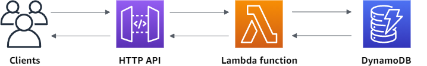

# Serverless CRUD API: API Gateway + AWS Lambda + DynamoDB

A serverless REST API that creates, reads, updates, and deletes student grade records. It has no servers to manage: **Amazon API Gateway (HTTP API)** routes each request to one **AWS Lambda** function (Node.js, AWS SDK v3), which reads and writes an **Amazon DynamoDB** table.



📄 **Step-by-step build guide with screenshots:** [PDF](Build%20a%20CRUD%20API%20with%20Lambda%20and%20DynamoDB.pdf) · [DOCX](Build%20a%20CRUD%20API%20with%20Lambda%20and%20DynamoDB.docx)

## Tech stack

| Component | Service / detail |
|---|---|
| API layer | Amazon API Gateway HTTP API (`students_grade_sheet_api`) |
| Compute | AWS Lambda, Node.js ES module, `@aws-sdk/lib-dynamodb` (`students_grade_sheet_function`) |
| Database | Amazon DynamoDB table `students_grade_sheet`, partition key `id` (String) |
| Security | IAM execution role `students_grade_sheet_role` built from the *Simple microservice permissions* policy template |
| Testing | `curl` from an EC2 instance |

## API routes

All routes use one Lambda integration. The handler dispatches on `event.routeKey`.

| Method | Path | Action | DynamoDB call |
|---|---|---|---|
| `PUT` | `/items` | Create or update an item (`id`, `name`, `marks`) | `PutCommand` |
| `GET` | `/items` | List all items | `ScanCommand` |
| `GET` | `/items/{id}` | Get one item | `GetCommand` |
| `DELETE` | `/items/{id}` | Delete one item | `DeleteCommand` |

Source: [`lambda/index.mjs`](lambda/index.mjs)

## Example requests

```bash
API=https://<api-id>.execute-api.us-east-1.amazonaws.com

# Create or update
curl -X PUT -H "Content-Type: application/json" \
     -d '{"id": "124", "marks": 98, "name": "suhas"}' $API/items

# List all
curl $API/items

# Get one
curl $API/items/124

# Delete
curl -X DELETE $API/items/124
```

## How I built it

1. Created the DynamoDB table with `id` as the partition key.
2. Created the Lambda function with a least-privilege execution role from the *Simple microservice permissions* template, and deployed the handler in `lambda/index.mjs`.
3. Created an empty HTTP API in API Gateway with the default auto-deploy stage.
4. Added the four routes, including the `{id}` path parameter.
5. Created one Lambda integration and attached it to every route.
6. Tested each operation with `curl` against the API's invoke URL.

> The AWS resources from this project have been deleted, so the invoke URL in the documentation is no longer live.
